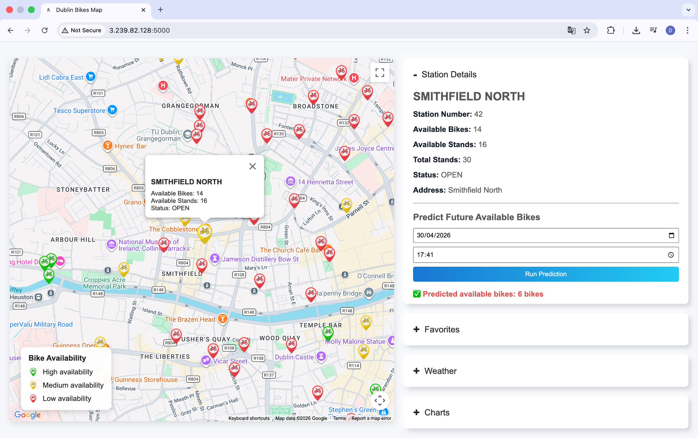
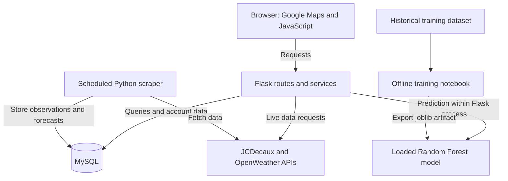
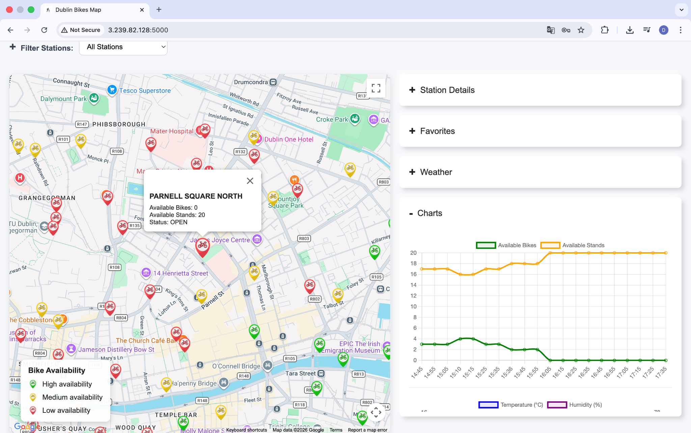
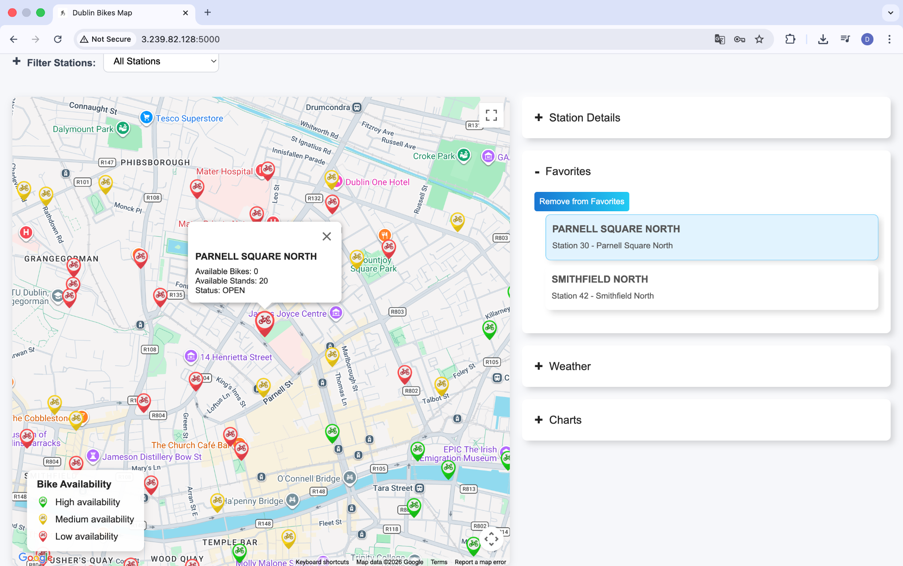

# Dublin Bikes Web Application

A full-stack web application that helps Dublin Bikes users find available bikes, check weather conditions, and estimate future bike availability for a selected station and time.

Built by a three-person team for **COMP30830 Software Engineering**, combining a Flask backend, MySQL data collection, an interactive Google Maps interface, and a deployed machine learning model.

**Status:** Coursework development is complete. This repository is retained as a portfolio archive and is no longer actively maintained. The application was deployed on AWS EC2 for the final demonstration; a continuously available hosted demo is not maintained as part of this archive.

**[Watch the demo on YouTube](https://youtu.be/9C4hoz_CmEE)** · [My contributions](#my-contributions) · [Architecture](#architecture) · [Run locally](#run-locally)



*Final demonstration: select a station, choose a date and time, and request an estimate of available bikes. Screenshots are taken from the original project report and show historical demo data.*

## Key features

- **Interactive station map:** Color-coded availability markers, station filtering, and station details showing available bikes and free stands.
- **Historical trends and weather:** Charts for recent station availability and weather forecasts to support journey planning.
- **Personalized favorites:** Registration, login, logout, and station favorites stored against each user account.
- **Scheduled data collection:** Python scrapers periodically fetch JCDecaux station data and OpenWeather data and persist them in MySQL.
- **Bike availability prediction:** A trained Random Forest uses station, time, and weather features to estimate the number of bikes available.

**Stack:** Python · Flask · JavaScript · HTML/CSS · Google Maps · Chart.js · MySQL · pandas · scikit-learn · joblib · pytest · AWS EC2

## My contributions

My work as **Derek** focused on the backend and data infrastructure within the team project:

- Set up the repository and organized the backend into routes, services, configuration, and database helpers.
- Implemented data collection and persistence for bike station availability and weather information.
- Designed the MySQL schema, separating station metadata from time-stamped availability records, weather data, users, and favorites.
- Contributed to authentication and favorites functionality, backend tests, and integration debugging.
- Helped verify the EC2 deployment and prepare project documentation and the final demonstration.

The interface, requirements work, model training, and application integration were delivered collaboratively across the team. The model results below describe the team's project outcomes.

## Architecture



The Flask application uses an application factory and separate blueprints for pages, live data, database-backed data, authentication, and favorites. Service modules handle SQL queries, external requests, and account operations. Prediction logic lives in the database API blueprint and loads the saved model at application startup.

### Engineering decisions

- **Preserve history:** Station metadata and time-stamped availability observations are stored separately, allowing new readings to be collected without overwriting previous observations. City-level weather is stored separately to avoid duplicating it for every station.
- **Separate collection from serving:** The scraper runs as a separate process, collecting station data every five minutes and weather data every ten minutes by default. The web application reads the stored history and forecasts while also exposing live-data routes.
- **Keep training offline:** Model comparison and training happen in a notebook; the web application loads the exported artifact once and performs inference for user requests.
- **Fit the model to deployment constraints:** The project report records model-loading failures on an EC2 t3.micro instance. Limiting tree complexity and applying joblib compression reduced the saved model from approximately 468 MB to 21 MB, followed by deployment on a t3.small instance. This is a reduction in artifact size; runtime memory requirements are separate.

## Machine learning results

The [training notebook](ml/model_training.ipynb) compares Linear Regression, K-Nearest Neighbors, Decision Tree, and Random Forest regressors using **298,946 cleaned records** and a **random 80/20 train–test split** (`random_state=42`).

The selected Random Forest achieved:

| Metric | Held-out test result |
| --- | ---: |
| Mean absolute error | 1.9903 bikes |
| Root mean squared error | 3.0434 bikes |
| R² | 0.9021 |

Its seven input features are station ID, hour, day of week, month, temperature, relative humidity, and barometric pressure. For inference, the backend derives time features from the selected date and time and uses the nearest stored hourly weather forecast. If weather lookup fails or returns no forecasts, it uses fixed default weather values.

**Evaluation limits:** These results come from a random split of historical observations. Nearby observations may appear in both partitions, so the scores do not establish accuracy on a future time period. No chronological backtest is included. The model is static, does not account explicitly for holidays or major events, and may perform differently as cycling patterns change.

**Included artifact:** [`ml/best_bike_model.joblib`](ml/best_bike_model.joblib), approximately 21 MB. Local inference uses this existing model and does not require retraining.

**Training data:** `ml/final_merged_data.csv` is not included. The notebook expects this prepared dataset as input; the repository does not contain a complete process for recreating it from the scraper output. Reproducing training therefore requires obtaining or reconstructing that dataset separately.

## More screenshots

### Station history and weather charts



*Inspect recent availability and weather trends alongside the selected station.*

### Saved favorite stations



*Signed-in users can save stations and return to them through the favorites panel.*

## Run locally

### Prerequisites

- Conda and a running MySQL server.
- Your own JCDecaux, OpenWeather, and Google Maps API credentials. The configured OpenWeather forecast endpoints require appropriate account access.
- Network access for external data collection, map tiles, and browser-loaded assets.

This is an archived coursework environment: dependency versions are not pinned in `environment.yml`, so recreating it with current packages may require compatibility adjustments, particularly when loading the saved scikit-learn model.

### 1. Create the environment

```bash
git clone https://github.com/Derek376/dublin-bikes-webapp.git
cd dublin-bikes-webapp
conda env create -n dublin-bikes-env -f environment.yml
conda activate dublin-bikes-env
```

### 2. Configure credentials

```bash
cp .env.example .env
```

Fill in the MySQL connection settings, JCDecaux key, OpenWeather key, and Google Maps key in `.env`. Add a `SECRET_KEY` value for Flask sessions. The default database name in the example is `comp30830_bikes`.

### 3. Create the database and tables

```bash
python -m scraper.create_tables
```

This creates the configured database and seven tables: `station`, `availability`, `current`, `hourly`, `daily`, `users`, and `favorites`. The configured MySQL user needs permission to create them.

### 4. Start data collection

```bash
python -m scraper.run_scraper
```

Keep this process running to populate and refresh station history and weather data. A new database has no historical observations; the history charts build up as readings are collected.

### 5. Start the application

In a second terminal, activate the same Conda environment, change to the repository root, and run:

```bash
python run.py
```

Open [http://127.0.0.1:5000](http://127.0.0.1:5000). The included entry point runs Flask in development mode. Select a station to inspect its availability and charts, request a prediction, or sign in to manage favorites.

## Testing

From the repository root, with the environment activated:

```bash
python -m pytest -q
```

The repository contains **20 backend tests**, covering page and health routes, mocked station and weather responses, authentication input validation, favorites access control, and prediction validation and weather fallback behavior. The final project report records all 20 passing before submission.

These are backend tests with a mixture of mocks and database-dependent behavior. They do not provide automated browser coverage or validate live model accuracy; prediction success tests mock the model output. The signed-in favorites test requires a configured database. Manual checks on EC2 supplemented the automated tests during the original project.

## Repository guide

```text
app/
  routes/       Page, data, authentication, favorites, and prediction routes
  services/     SQL queries, external requests, and account operations
  static/       JavaScript, CSS, and map assets
  templates/    Main application page
scraper/        Database initialization and periodic data collection
ml/             Training notebook and saved model
tests/          Backend test suite
docs/           Requirements, mockups, screenshots, and GenAI usage logs
```

## Team and project process

Developed by [Derek](https://github.com/Derek376), [Henry](https://github.com/flackothegoat), and [Jason](https://github.com/eelj457) across four Scrum sprints, covering requirements and data collection, backend integration, interface and account features, and machine learning with deployment verification.

Supporting materials include [user stories](docs/user-stories.md), [acceptance criteria](docs/acceptance-criteria.md), [personas](docs/personas.md), and [GenAI usage logs](docs/genai-logs).

## License

[MIT](LICENSE).
