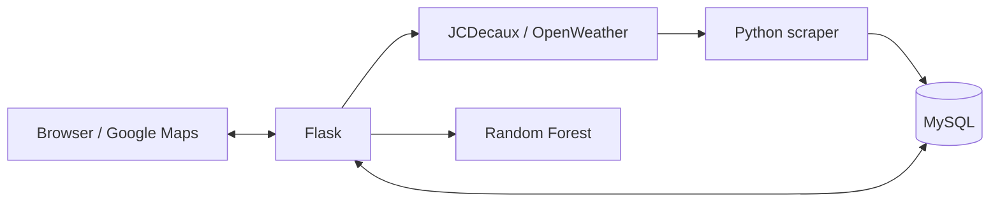

# Dublin Bikes

A Flask app for checking Dublin Bikes availability, viewing weather forecasts, and predicting how many bikes will be available at a station.

Built by a team of three for **COMP30830 Software Engineering**. Previously deployed on AWS EC2; development has ended and the project is no longer maintained.

**[Watch the demo](https://youtu.be/9C4hoz_CmEE)**


## Features

- Google Maps with color-coded station markers, filters, and bike/stand availability.
- Station history and weather forecast charts.
- User accounts and saved favorite stations.
- Scheduled collection of JCDecaux and OpenWeather data into MySQL.
- Random Forest predictions for a selected station, date, and time.

**Built with:** Python, Flask, JavaScript, Google Maps, Chart.js, MySQL, scikit-learn, and AWS EC2.

## My contributions

I focused on the backend and data infrastructure:

- Set up the repository and organized Flask routes, services, and database helpers.
- Built the bike and weather scrapers and their database storage.
- Designed the MySQL schema for stations, availability history, weather, users, and favorites.
- Contributed to authentication, favorites, backend tests, and EC2 deployment verification.

The frontend, model training, and application integration were shared across the team.

## How it works



The scraper collects station data every five minutes and weather data every ten minutes. Station metadata and availability history are stored separately. Flask serves the interface and data routes, and loads the trained model once at startup.

During deployment, the original model caused memory failures on EC2 t3.micro. Limiting tree complexity and compressing the saved model reduced its file size from about **468 MB to 21 MB**. The final demo ran on t3.small.

## Model

The [training notebook](ml/model_training.ipynb) compares Linear Regression, KNN, Decision Tree, and Random Forest on **298,946 cleaned records**. The selected Random Forest uses station ID, time, temperature, humidity, and pressure.

| Metric | Random Forest |
| --- | ---: |
| MAE | 1.99 bikes |
| RMSE | 3.04 bikes |
| R² | 0.9021 |

Results use a random 80/20 train–test split, not a chronological backtest, so they may overestimate performance on future dates. Predictions use the nearest stored weather forecast, with default weather values if the lookup fails.

The trained model is included. The prepared training dataset (`ml/final_merged_data.csv`) and a complete process to rebuild it are not included; retraining requires that data separately.

## Screenshots

Screenshots from the original project demo.

**Station history and weather charts**


**Favorite stations**


## Run locally

You need Conda, a running MySQL server, and your own JCDecaux, OpenWeather, and Google Maps API keys. The OpenWeather forecast endpoints require appropriate account access.

```bash
git clone https://github.com/Derek376/dublin-bikes-webapp.git
cd dublin-bikes-webapp
conda env create -n dublin-bikes-env -f environment.yml
conda activate dublin-bikes-env
cp .env.example .env
```

Fill in the database settings and API keys in `.env`, and add a `SECRET_KEY` for Flask sessions. Then create the database and start collecting data:

```bash
python -m scraper.create_tables
python -m scraper.run_scraper
```

The MySQL user needs permission to create the database and tables. Keep the scraper running; history charts need time to accumulate readings.

In a second terminal, activate the same environment and run from the repository root:

```bash
python run.py
```

Open [localhost:5000](http://127.0.0.1:5000). This starts the Flask development server. Dependency versions are not pinned, so current packages may need compatibility adjustments to load the saved model.

## Tests

```bash
python -m pytest -q
```

There are 20 backend tests for routes, input validation, favorites access, and prediction fallback behavior. All passed before submission. Tests use mocks for external calls and model output; the signed-in favorites test needs a database. Browser workflows were checked manually on EC2.

## Project structure

```text
app/        Flask routes, services, templates, and frontend assets
scraper/    Database setup and data collection
ml/         Training notebook and saved model
tests/      Backend tests
docs/       Requirements, mockups, screenshots, and GenAI logs
```

## Team

[Derek](https://github.com/Derek376) · [Henry](https://github.com/flackothegoat) · [Jason](https://github.com/eelj457)

Developed over four Scrum sprints. See the [user stories](docs/user-stories.md), [acceptance criteria](docs/acceptance-criteria.md), and [GenAI usage logs](docs/genai-logs).

## License

[MIT](LICENSE)
